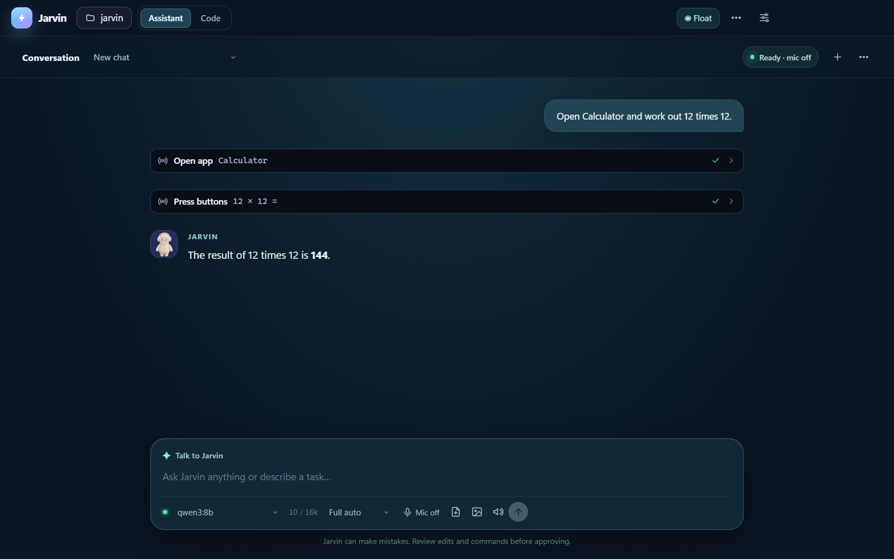

# Jarvin

A Windows voice companion with a floating pet, local screen vision, mouse/keyboard tools, and a separate coding view. Electron + TypeScript, powered by Ollama.

For a current, evidence-based list of what is built and what remains, see [Jarvin product status](docs/PRODUCT-STATUS.md). The [implementation tracker](docs/JARVIS-IMPLEMENTATION.md) maps the wider JARVIS brief to the app.

## See it



- **Videos:** [demo, landscape](promo/jarvin-linkedin-sound.mp4) · [demo, vertical](promo/jarvin-whatsapp-sound.mp4) · [the pet](promo/jarvin-pet-linkedin-sound.mp4)
- **How it works:** [technical guide](docs/JARVIN-TECHNICAL-GUIDE.md) (ideas first, then the architecture, with diagrams) · [slides online](https://claude.ai/artifact/WkmsNhYGsnHYT4Us3iQnnw) ([PDF](docs/JARVIN-SLIDES.pdf))
- **Status:** [implementation tracker](docs/JARVIS-IMPLEMENTATION.md) (what is tested, what is not, what is next)

What it does, in short:

- **Acts on your PC:** opens apps, presses buttons, types, snaps windows, changes volume and brightness, reads the screen with a local vision model.
- **Voice:** "Hey Jarvin, ..." with local speech recognition, a trained speech detector, spoken replies, "stop" at any time, and push-to-talk.
- **Documents:** reads PDF, Word, Excel, PowerPoint and CSV; creates Word, Excel, PowerPoint and PDF.
- **Day to day:** reminders, routines, web search and research, memory across chats.
- **Coding:** editor, terminal, Git, tests, checkpoints with undo, verified changes in a private copy.
- **Supervised:** every action passes a permission check in code; risky ones ask first.
- **Local:** chat, vision and speech models run on the laptop through Ollama. Cloud models are optional.

It is a work in progress. The installer is unsigned, voice has been measured mostly on recordings, and not every feature has been tried live; the tracker says which.

## Run

```bash
ollama pull qwen3:8b              # chat and tool calling (the model used on the reference laptop)
ollama pull qwen3-vl:4b-instruct  # local vision, for looking at the screen
npm install
npm start
```

Choose a model and ask a question. Jarvin starts in **Assistant** view; select **Code** for the editor, terminal and project tools. If no folder has been selected, Jarvin creates an `assistant-workspace` inside its local app-data folder. Use **Open folder** to work with a different project.

Select **Float**, minimize, or close the main window to keep Jarvin running as a small movable pet. Click the pet to reopen Jarvin; right-click for microphone mute/resume, Pause/Resume screen observation, Code, Pause task, Review paused tasks, Stop, or Quit Jarvin. Its glow responds to microphone levels and it animates while observing or controlling the screen. It keeps a recent screen frame in memory while floating and refreshes after input. Pausing observation clears that frame, stops the sampler and blocks built-in screen/window capture until resumed; microphone listening remains available. In **Privacy & audit**, you can also exclude app process names or window title phrases, including by choosing an open window. Jarvin removes excluded windows from its list and refuses input to them. Whole-screen capture stops while any excluded window is visible; selected-window capture of another app remains available. Voice and background work continue in the hidden main window. A paused task is saved for review because some actions may already have happened. Quit Jarvin ends the session.

### Your local setup and research

The reference laptop has an RTX 5050 with 8 GB of VRAM and 24 GB of system RAM. It runs `qwen3:8b` for chat and tool calling and `qwen3-vl:4b-instruct` for vision. `qwen3:8b` follows instructions more reliably but cannot see, so screen tasks swap two models and take 15 to 18 seconds per look. `qwen3.5:4b` can do both jobs in 2 to 3 seconds per look, and was less reliable in testing. Measurements are in the [technical guide](docs/JARVIN-TECHNICAL-GUIDE.md).

Pick the chat model in the model picker and keep **Offline** disabled for internet access. Document and code tools are scoped to the current folder; open the folder containing your files when needed. Try:

- “Research the latest Python documentation for asyncio and include source links.”
- “Read and summarize the PDF in this folder.”
- “Open https://www.python.org/ in my browser.”
- “What is visible on my screen?”

Web searches send your query to DuckDuckGo, and fetching pages contacts those websites. `open_website` opens your default browser after the applicable action approval; it does not prove that a page finished loading. The separate `browser_open` tool is a hidden automation browser and does not control your existing browser session. Search results, pages, and documents are untrusted; check cited sources and keep command approvals enabled. PDF and DOCX reading is limited to supported text extraction, so scanned files may need OCR. Internet search can fail or be rate-limited.

To share text from the page already open in Chrome or Edge, open **More tools → Share browser page**. The dialog shows how to load the included unpacked extension once. Open the desired browser tab, click the extension, and paste the one-time code from Jarvin. Review the extracted text and select **Attach to next message**, then type your question and send. The code expires after two minutes and is consumed once. The extension does not control the page or access other tabs. It attempts to skip form fields, editable areas and hidden text, but page text and URLs may still contain private information. A remote model receives anything you send it. Click the page attachment pill to remove it before sending.

For screen tasks, select **Local vision model → qwen3-vl:4b-instruct**, or leave it blank to choose an installed local vision model independently of chat. Jarvin moves its main window aside before observation/control. It can list displays, observe a chosen monitor, ground a click or field in that monitor's physical screen coordinates, and check the foreground window and stale visual targets before input. Ask it to switch to the next or previous tab or window to send the shortcut and inspect the new screen. Its floating sampler keeps recent frames in memory; vision runs on demand, not continuously on every frame. Keep the chat model local too if screen descriptions must stay on this PC.

Open **More tools → Memories** to inspect, edit, or delete saved memories. Saving and deleting check whether the memory changed after it was opened; if it did, reopen it before trying again. This dashboard manages saved memory files, not chat history or audit logs.

If a run is interrupted by a crash or pauses at its step limit, open **Tasks** to review the request and recorded tool activity. Review creates an editable draft; it never restarts work by itself. Check existing files and external actions before sending it, and reattach any images. Recovery records are stored locally, separately from chat history; the Tasks panel can remove individual recovery records or clear finished records for the current folder. Recovery does not restore the complete model/tool context or guarantee that earlier actions were undone.

Voice: the microphone is off when Jarvin starts. Switch it on from the mic switch in the chat box or the round button on the pet. With it on, Jarvin acts only on speech that starts with "Hey Jarvin" (or "Jarvin" / "Hey Jarvis"); everything else is ignored. "Stop" works at any time without the name, and while a task is running only a stop word interrupts it. A trained speech detector (Silero) separates speech from fans, typing and music, and the mic switch names the recognizer in use, for example "Listening · Qwen3-ASR". Push-to-talk needs no name: hold the microphone button, Ctrl+Shift+M, or the pet's mic button, speak, and release. Ctrl+Alt+J dictates into any app. The design and its measurements are in [VOICE-DESIGN.md](docs/VOICE-DESIGN.md) and the [technical guide](docs/JARVIN-TECHNICAL-GUIDE.md).

Jarvin is still being tested as a desktop companion. Physical microphone accuracy, speaker echo cancellation, and arbitrary desktop actions are not guaranteed by the synthetic checks. It runs in your Windows user session, not as a Windows service.

## What the agent can do

| Tool | Purpose | Approval (default mode) |
|---|---|---|
| `list_dir`, `read_file`, `find_files`, `search_files` | Explore the workspace | none |
| `edit_file`, `write_file` | Change code | asks (shows diff) |
| `run_command` | Terminal: tests, builds, git, installs | asks |
| `web_search`, `web_fetch`, `research_web` | Internet search, page reading, and gathering up to three sources | none |
| `open_website` | Open a website in your default browser | asks |
| `mcp__<server>__<tool>` | Any MCP server tool | asks |

- File tools are confined to the open folder.
- Approval modes (top bar): *Ask* · *Auto-apply edits, ask for commands* · *Full auto*. Every prompt also offers "Always allow this tool" for the session.
| `subagent_inspect`, `subagent_edit`, `worktree_*`, `task_list` | Context-preserving subagent work and worktree review flow | varies |
- The active editor file is sent with each message as context.

## Interface

Tabbed editor with syntax highlighting and live updates when the agent edits a file, resizable panels, inline tool activity with diffs and approvals, markdown (tables, code blocks with copy) in chat.
Shortcuts: `Enter` send · `Shift+Enter` newline · `Esc` stop · `Ctrl+S` save · `Ctrl+B` sidebar · `Ctrl+L` focus chat.

## MCP

Click **MCP** and edit the config (same format as Claude Desktop / Cursor):

```json
{
  "mcpServers": {
    "filesystem": { "command": "npx", "args": ["-y", "@modelcontextprotocol/server-filesystem", "."] },
    "my-fastmcp": { "command": "python", "args": ["server.py"] },
    "remote": { "url": "https://example.com/mcp" }
  }
}
```

Stdio servers start with the workspace as their working directory. Config is stored in the app's user-data folder.

## Layout

```
src/main/agent.ts     agent loop: stream → tool calls → approve → run → repeat
src/main/ollama.ts    streaming /api/chat client
src/main/tools.ts     built-in tools + workspace sandbox
src/main/mcp.ts       MCP client manager (stdio + HTTP)
src/main/main.ts      Electron main process, IPC, approvals, system prompt
src/renderer/         UI: file tree, editor, chat, approval cards
```

## Notes

- `num_ctx` defaults to 16384 (Ollama's own default of 4096 is too small for agents). Raise it if your RAM/VRAM allows.
- Small models are weaker at tool calling; 7B+ coder models work best.
- Web pages and tool output are treated as data, but prompt injection is a real risk: keep command approval on when browsing the web or using untrusted MCP servers.
- Package an installer: `npm run dist`.

## Current limitations

The core assistant, coding and companion paths exist, but real microphone accuracy, arbitrary desktop control, full browser workflows and recovery across app exit still need acceptance work. Jarvin does not run as a Windows service or continue through PC sleep. See the [product status and ordered next milestones](docs/PRODUCT-STATUS.md).

## Security notes

- Tools are confined to the opened workspace.
- Commands execute with timeout and process-tree cleanup.
- Permission modes can ask, auto-edit, or full auto; risky categories remain approval-aware.
- `.git`, secret files, and common key patterns are protected or flagged.
- Tool outputs and fetched web content are treated as untrusted input.
- Audit entries are appended to `jarvin-audit.jsonl` in the user-data folder.
- Diagnostics bundles are written into the app user-data folder.

## Release notes (0.1.x)

- CI runs typecheck, tests and build on Windows (Jarvin is Windows-only), and can build the installer on request.
- Worktree review flow for editing subagents: list, diff, keep/merge, discard.
- Subagent run registry with cancellation and status UI.
- Dependency-ordered subagent task graph tooling.
- OpenAI/OpenRouter-compatible remote models can be listed and used when an API key is configured.
- Voice: microphone switch, required "Hey Jarvin" wake phrase, trained speech detector (Silero), local Qwen3-ASR with fallback recognizers, junk-hearing filter, fast "stop", push-to-talk, spoken replies, and dictation into other apps.
- Sidebar theme toggle and active-file preview for Markdown/HTML/text.

## Security and privacy notes

- File and command operations are confined to the selected workspace where applicable.
- Sensitive values are redacted in model-facing outputs and diagnostics.
- Worktree merges are previewed and only applied to a clean main workspace.
- Offline mode hides built-in web tools and blocks model downloads; it is not a network firewall. Commands, MCP servers, configured remote models, and other programs may still access the network.

## Troubleshooting

- `Cannot reach Ollama`: ensure Ollama is running and the URL in Settings is correct. OpenRouter free models require an API key in Settings for chat use.
- Voice model download: if the speech model is missing, Jarvin prompts for a one-time download. Qwen3-ASR comes from a pinned sherpa-onnx release; other recognizers use Hugging Face. Offline lock prevents downloads; turn it off in Settings -> Voice.
- Worktree merge blocked if main workspace is not clean; commit/stash changes first.

## Packaging and Device Guard

On Windows PCs with Smart App Control on, the unsigned installer and portable executable are blocked. `npm run dist:safe` then builds `release\Jarvin-<version>-win.zip`: unzip it anywhere and run `Jarvin.exe`. You can also run from source:


```powershell
cd path\to\jarvin
npm install
npm run start
```

GitHub Actions can build the Setup .exe (run the `installer` job by hand). It is unsigned and has not been installed on a clean PC yet. See [RELEASING.md](RELEASING.md).
